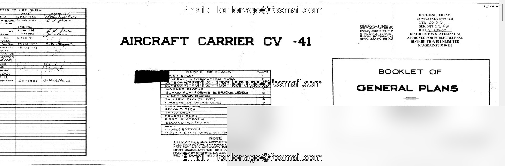
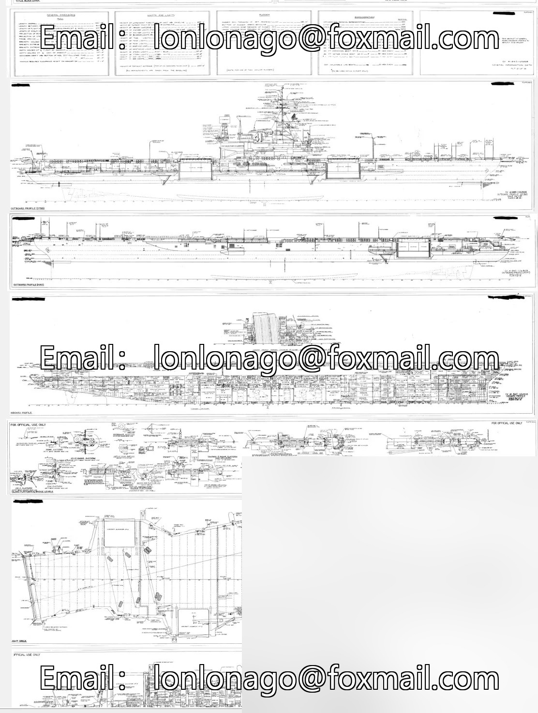
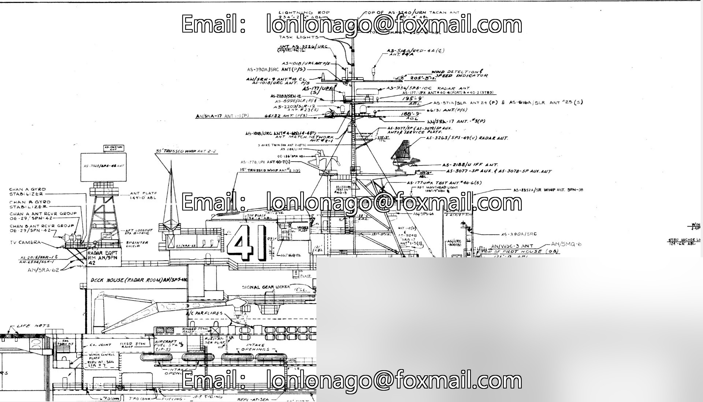
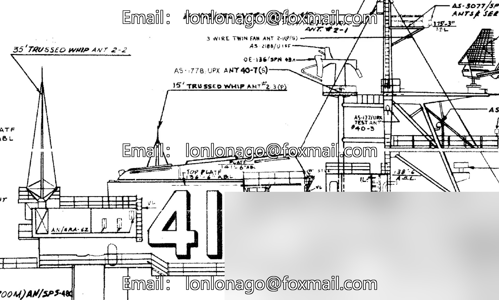
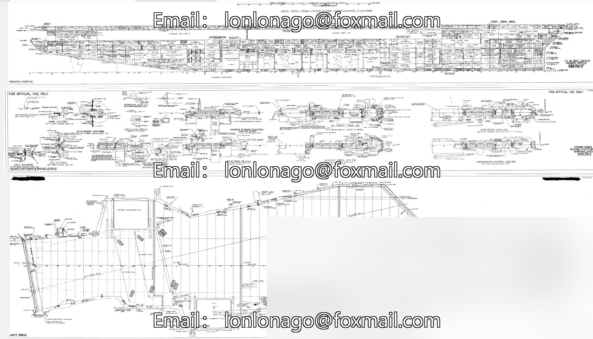
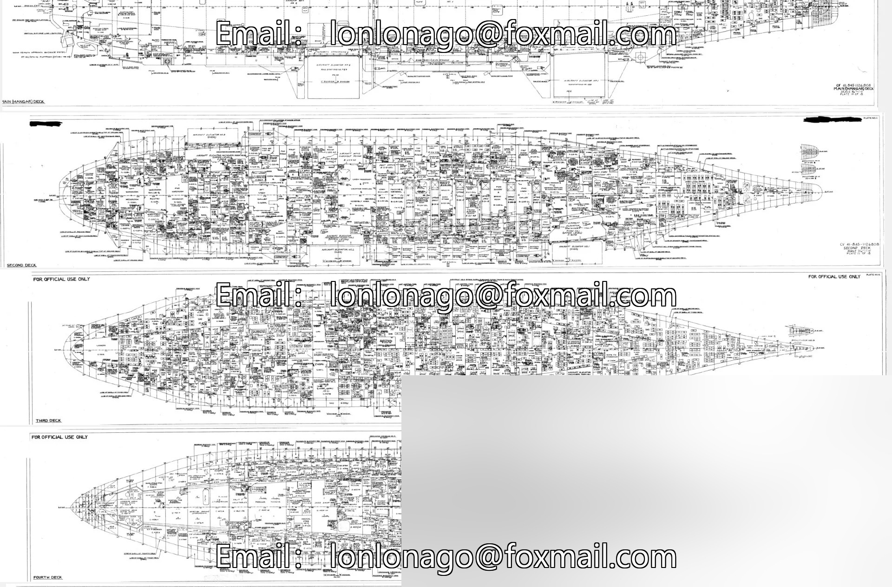
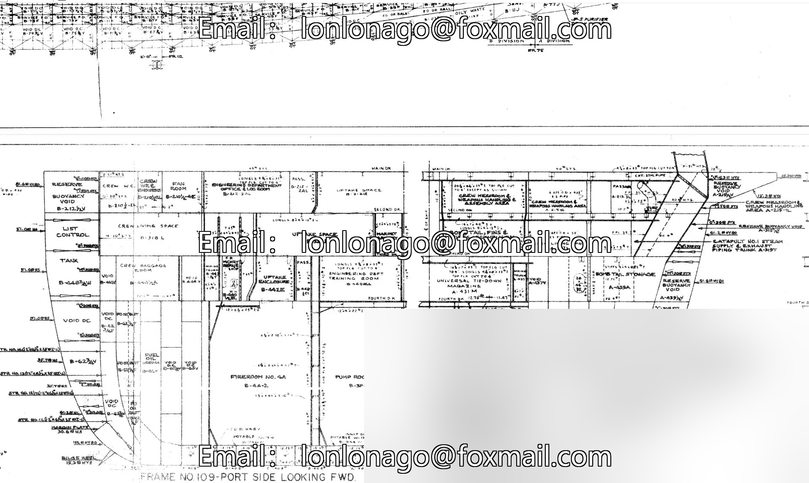

# Campaign Aircraft Carrier (CV-41) Overall Layout Manual, 1987 original version

## Body

The General Layout Book of the Midway aircraft carrier (CV-41), original materials from 1987.
1. Core content
A detailed layout chart of the US Navy Midway-class aircraft carrier (USS Midway)
Plan views of key areas including the hull length, flight deck, hangar, and power equipment
Distributions of important equipment such as carrier aircraft landing facilities, radar positions, and communication antenna
Detailed diagrams of internal configurations including the hull structure, internal cabin areas, and living quarters
2. Features
Official publication of the complete draft in 1987
Containing detailed layouts of all important systems and structures of the hull
Suitable for use by military enthusiasts, model making, and research reference
not refundable upon sale.

The Midway-class aircraft carrier overview booklet includes 1987 original materials, covering core layouts, key area plans and detailed structural configurations.

<!-- AI_ENRICHED -->

## Images

## Payment

Here is a pay link on Stripe ( https://buy.stripe.com/3cs8yP7sY87d0vu9AB ). Please contact me lonlonago@foxmail.com after funding $89, and I will send you a complete data files , thank you!

